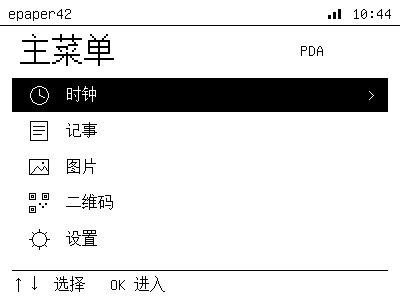
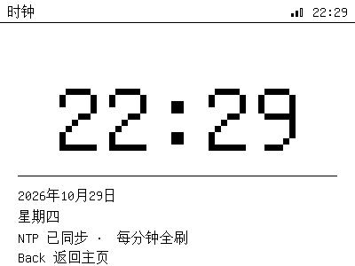
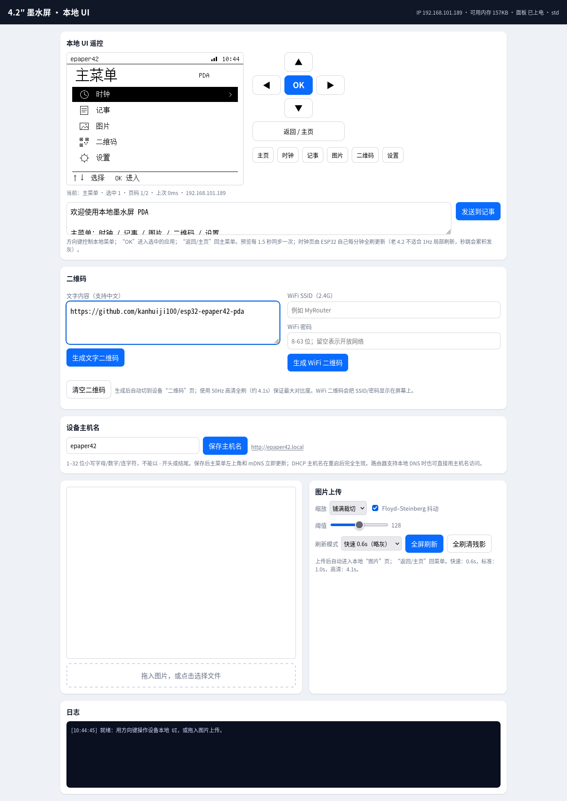

# ESP32 4.2″ e-Paper PDA

A local-first PDA built on an ESP32 and a Waveshare 4.2″ e-paper panel
(WFT0420CZ15 / UC8176, 400×300). The device renders its own UI (menu, clock,
notes, image viewer, QR codes, settings); a browser is only used as a remote control
and image uploader.

The project also documents how the stock Waveshare loader was sped up from
**~8.6 s to 0.6 s** for a full image, and why this old panel cannot do a clean
1 Hz partial-refresh clock.

[中文说明见下](#中文说明)。 ｜ [Investigation notes](docs/INVESTIGATION.md) ｜ [API](docs/API.md) ｜ [Hardware](docs/HARDWARE.md)

---

## Highlights

- **Local UI on the ESP32** — 400×300 1bpp framebuffer, GB2312 + ASCII bitmap font.
- **Six screens** — Home, Clock, Notes, Image, QR, Settings.
- **Web remote** — live 15 KB screen mirror, D-pad, app shortcuts, note editor,
  text/Wi-Fi QR generator.
- **Fast refresh** — full image in **0.61 s** (device), **0.69–0.80 s** round trip.
- **Quality modes** — 0.61 s / 0.98 s / 4.14 s full-refresh waveforms.
- **Partial updates** — 0.58 s window updates for status bar / small changes.
- **Persistent notes** — stored in NVS and rendered locally.
- **No vendor cloud/app** — Wi-Fi HTTP only, all rendering on-device.
- **Serial console** — provision Wi-Fi, simulate D-pad/keys, switch apps, edit notes,
  generate text/Wi-Fi QR codes, inspect status and print an ASCII screen preview.
- **Max-contrast QR** — text or `WIFI:` join code, drawn with the 50 Hz 4.14 s
  waveform and a 4-module quiet zone.
- **Custom hostname** — default `epaper42`; change it from the web card, serial
  console or API. The Home status bar and Settings show it, and mDNS serves
  `http://<hostname>.local` immediately.

## Measured results

| Operation | Stock loader | This project |
|---|---:|---:|
| Full image + display (fast) | **8.6 s** measured (init 2.68 / transfer 1.48 / refresh 4.45) | **0.61 s** device, **0.69–0.80 s** round trip |
| Full image (standard waveform) | — | **0.98 s** |
| Full image (HQ 50 Hz) | ~4.1 s | **4.14 s** |
| 400×40 partial window | — | **0.58 s** |
| Menu / app switch / notes page | — | **0.98–1.0 s** (standard full waveform) |
| Clock | — | **0.98 s once per minute**, static in between |
| Boot to local home | — | **~2.2 s** |

> The user-observed “about 5 s” and the reproduced 8.6 s differ by image
> content, Wi-Fi conditions and whether initialization is included. Both are
> well above the new result.

## Screenshots

| Local home (5 menu items) | Minute clock |
|---|---|
|  |  |

| QR screen (HQ waveform) | Web UI: QR + hostname cards |
|---|---|
|  |  |

## Hardware

- **Board:** Waveshare e-Paper ESP32 Driver Board (ESP32-D0WDQ6, 4 MB flash, no PSRAM).
- **Panel:** WFT0420CZ15, 4.2″, 400×300, black/white, UC8176 controller.
- **Interface:** 4-wire SPI, 10 MHz in this project.

Pin map:

| Signal | GPIO |
|---|---:|
| SCK | 13 |
| MOSI | 14 |
| CS | 15 |
| BUSY | 25 |
| RST | 26 |
| DC | 27 |
| CS_S (secondary) | 2 |
| EPD power enable | 33 |

More: [docs/HARDWARE.md](docs/HARDWARE.md).

## Quick start

### 1. Toolchain

Install [arduino-cli](https://arduino.github.io/arduino-cli/) and the ESP32 core 2.0.17:

```bash
arduino-cli config init
arduino-cli config add board_manager.additional_urls \
  https://espressif.github.io/arduino-esp32/package_esp32_index.json
arduino-cli core update-index
arduino-cli core install esp32:esp32@2.0.17
```

### 2. Wi-Fi provisioning

The firmware can be flashed **without** `secrets.h` and provisioned entirely over
the USB serial console. After flashing, open the port at **115200** and type:

```text
wifi set
SSID: <your 2.4 GHz SSID>
Password (hidden): ********
WiFi: saved to NVS
IP: 192.168.x.x
```

Credentials are saved in NVS namespace `wifi` and are reused on every boot. The
password is not echoed; `wifi scan` lists visible 2.4 GHz networks first.

If you prefer compile-time defaults, copy the example:

```bash
cd firmware/epaper42_web
cp secrets.example.h secrets.h   # edit WIFI_SSID / WIFI_PASSWORD
```

`secrets.h` is git-ignored; NVS credentials take precedence over it. The
placeholder fallback also keeps CI and `arduino-cli compile` working without any
secrets file.

### 3. Build and flash

```bash
# from repository root
./flash.sh /dev/ttyACM0
# or:
arduino-cli compile --fqbn esp32:esp32:esp32 firmware/epaper42_web
arduino-cli upload -p /dev/ttyACM0 --fqbn esp32:esp32:esp32 firmware/epaper42_web
```

Serial monitor at **115200**:

```
=== E-Paper 4.2 fast web console ===
boot clear: total=1248 init=263 data=26 refresh=959
WiFi..........
IP: 192.168.1.50
mDNS: http://epaper42.local
HTTP server on :80
local UI ready
```

Open the printed IP, or the default mDNS name `http://epaper42.local` on
mDNS-capable networks. The **设备主机名** card lets you change the hostname; the
same can be done from serial with `host <name>`. The new name is served as
`http://<name>.local` immediately (DHCP hostname after reboot).

### 4. Operate

- **D-pad** `▲▼◀▶`, **OK**, **Back/Home**; or click app shortcuts.
- **Clock** is local: it refreshes once per minute with a full waveform; no
  seconds are shown (see limitation below).
- **Notes**: type in the page, click “发送到记事”; the ESP32 wraps/paginates and
  stores the text in NVS.
- **Image**: choose an image, pick a refresh mode, click “全屏刷新”; the device
  switches to the image viewer. Back/Home returns to the menu.
- **Hostname**: the **设备主机名** card (or serial `host <name>`) updates the Home
  status bar, Settings and mDNS. Open `http://<name>.local`; 1–32 chars `a-z 0-9 -`.
- **Serial console**: 115200 baud, `help` for commands. `wifi set` is interactive,
  `key`/`app`/`note` simulate input, `screen` prints an ASCII preview. See
  [docs/SERIAL_CONSOLE.md](docs/SERIAL_CONSOLE.md).

## Repository layout

```
firmware/epaper42_web/
├── epaper42_web.ino   Wi-Fi, NTP, HTTP routes, serial logs
├── panel42.h          UC8176 driver: SPI, LUTs, full/fast/partial refresh
├── ui.h               public UI API
├── ui_impl.h          framebuffer, font, 6 screens, QR rendering, diff refresh
├── ui_font.h          generated 1bpp Unifont (7447 CJK + ASCII)
├── webpage.h          inline remote control + image uploader
├── serial_console.h   USB serial console: Wi-Fi provisioning, keys, notes, QR, preview
├── qrcodegen.h/.c     Nayuki QR Code generator (MIT)
└── secrets.example.h  optional compile-time Wi-Fi template

tools/
├── gen_font.py        regenerate ui_font.h from GNU Unifont
├── api_test.py        image/partial API timing test
├── ui_remote_test.py  Playwright end-to-end remote test
├── legacy_upload_test.py  stock-loader protocol benchmark
└── requirements.txt

docs/
├── API.md
├── HARDWARE.md
├── INVESTIGATION.md
├── LOCAL_UI.md
├── SERIAL_CONSOLE.md
├── QRCODE.md
└── images/
```

## How it works

**Driver.** `panel42.h` owns SPI, reset/power sequencing, three LUT sets and the
framebuffer shadow. A frame is 15,000 bytes (400/8 × 300), 1 = white, 0 = black.

**Refresh classes.**

| Mode | Waveform | Data | Time | Use |
|---|---|---|---:|---|
| `MODE_PART` + `fullFast` | GxEPD2 partial LUT, 100 Hz | inverted | 0.58 s | fast full image |
| `MODE_PART` + `partialFb` | GxEPD2 partial LUT, 100 Hz | inverted | 0.58 s | small window update |
| `MODE_STD` + `fullStd` | Waveshare fast full LUT, 100 Hz | normal | 0.98 s | UI transitions, images |
| `MODE_HQ` + `fullHq` | original 50 Hz LUT | normal | 4.14 s | photos / QR / maximum black |

**Local UI.** Each screen is drawn into `ui::fb`; `commit()` compares it with
`panel42::shadow` byte-by-byte and sends only the changed rectangle. A large
change uses `fullStd`; a small one uses `partialFb`. The clock is special:

- minute changes use **fullStd once per minute** (0.98 s), static in between;
- 1 Hz partial refresh was removed because the old 4.2 panel fades visibly after
  ~35 s (see [docs/INVESTIGATION.md](docs/INVESTIGATION.md));
- other pages update the status-bar minute with a small partial window, plus a
  full cleanup every 15 minutes;
- the QR screen is static and always drawn with `fullHq` when a valid code is
  shown, so the code is never disturbed by partial updates.

**Fonts.** `tools/gen_font.py` renders GNU Unifont at 16 px into 1bpp bitmaps:
7447 GB2312 characters/punctuation at 16×16 and 95 ASCII glyphs at 8×16.
Rare characters outside GB2312 render as a box.

## HTTP API

See [docs/API.md](docs/API.md) for the full reference. Quick examples:

```bash
# local UI state, screen, keys
curl http://<ip>/api/ui
curl -o screen.bin http://<ip>/api/screen          # 15000 bytes
curl -X POST 'http://<ip>/api/key?k=down'
curl -X POST 'http://<ip>/api/app?name=clock'

# notes (UTF-8, <= 4095 bytes)
curl -X POST --data-binary '今天要做的三件事…' \
  -H 'Content-Type: text/plain; charset=utf-8' \
  http://<ip>/api/note

# full image: mode=fast|std|hq, 15000 bytes
curl -X POST --data-binary @frame.bin 'http://<ip>/api/full?mode=fast'

# hostname (shown on Home/Settings; mDNS restarts immediately)
curl -X POST 'http://<ip>/api/host?name=pda42'
curl http://<ip>/api/host

# QR: text, Wi-Fi, clear (HQ 50 Hz, ~4.1 s)
curl -X POST --data-binary 'hello QR' 'http://<ip>/api/qr?type=text'
curl -X POST 'http://<ip>/api/qr?type=wifi&ssid=MyRouter&pass=my%20pass'
curl -X POST 'http://<ip>/api/qr?type=clear'

# full-refresh current frame (clean ghosting)
curl -X POST http://<ip>/api/refresh
```

## Limitations

- **No physical buttons yet.** Input is the web remote or the USB serial console
  (`key ...`). `ui::key()` is ready to be wired to GPIO buttons/encoder.
- **Old 4.2 cannot do a clean 1 Hz clock.** The partial waveform degrades the
  whole panel contrast after ~35 s of 1 Hz updates. The clock is minute-level.
  For seconds, use a 4.2″ V2 panel or accept 10 s-level updates / faster aging.
- **Images and QR codes are RAM-only.** The last image/QR is lost on reboot; notes
  persist in NVS.
- **GB2312 subset font.** Emoji and rare Chinese characters show a box.
- **QR is limited to version 13 (69 modules).** ECC M, 4-module quiet zone; longer
  payloads return HTTP 400. The QR screen always uses the 4.14 s HQ waveform.
- **Hostname:** 1–32 lowercase letters/digits/hyphens, no leading/trailing `-`.
  mDNS changes immediately; the DHCP hostname is applied on the next boot. Some
  clients need Avahi/Bonjour to resolve `.local`.
- **No OTA.** The app is at 86% of the 1.31 MB partition; an OTA layout needs a
  smaller font or a custom partition table.
- **Panel is powered off after 120 s idle** (except the clock screen) to save
  power; the ESP32 stays awake for HTTP. Deep sleep/wake is future work.
- **Vendor firmware/backup is not in this repo.** Always back up your own 4 MB
  flash before experimenting; the stock image contains your Wi-Fi credentials.

## License

Original code: **MIT** — see [LICENSE](LICENSE).
Third-party components and font data: [THIRD_PARTY_NOTICES.md](THIRD_PARTY_NOTICES.md).

Waveshare EPD_4in2 and GxEPD2 are MIT-licensed. The QR generator is the Nayuki
QR Code generator library (MIT); see [docs/NAYUKI_QR_LICENSE.txt](docs/NAYUKI_QR_LICENSE.txt).
The generated font bitmap is derived from GNU Unifont (GPLv2+ with font embedding
exception); see the notice file for details.

## 中文说明

这是一个 **ESP32 + 4.2 吋墨水屏（WFT0420CZ15 / UC8176，400×300）** 的本地优先
PDA 项目。ESP32 自己维护画布并渲染主菜单、时钟、记事、图片、二维码、设置；
网页只做遥控器、图片上传和二维码输入。

- 整屏图片从原厂约 **8.6 s** 降到 **0.61 s**（设备端），浏览器往返 **0.7–0.8 s**。
- 菜单/切页/记事翻页用标准全刷约 **1.0 s**；时钟**每分钟整分全刷一次**。
- 老 4.2 的局部波形不能做 1 Hz 时钟：约 35 秒后整屏发灰，因此时钟不显示秒。
- 串口控制台 115200：`wifi set` 配网、`key` 模拟按键、`qr`/`qr wifi` 生成二维码、
  `host` 修改主机名。
- 主机名默认 `epaper42`；网页“设备主机名”卡片或串口 `host <name>` 可改，主菜单
  左上角/设置页同步显示，mDNS 立即变为 `http://<name>.local`；DHCP 主机名重启生效。
- 二维码：网页或串口输入文字/SSID+密码，自动切到二维码页，用 50Hz 高清全刷
  （约 4.1s）保证最大对比度；二维码页保持静止，不做局部刷新。
- 记事存 NVS；图片和二维码只在 RAM；暂未接实体按键，由网页/串口操作。

烧录后可不填 `secrets.h`，直接用串口 `wifi set` 配网；也可以复制
`secrets.example.h` 为 `secrets.h` 作为编译期 fallback。详细构建、API、硬件和
实验记录见 [docs/](docs/)。
