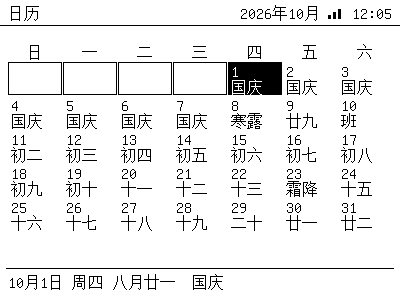
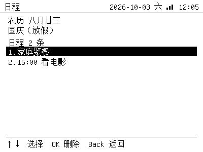
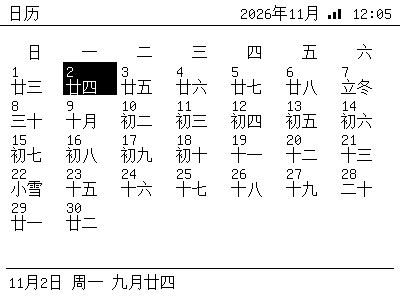
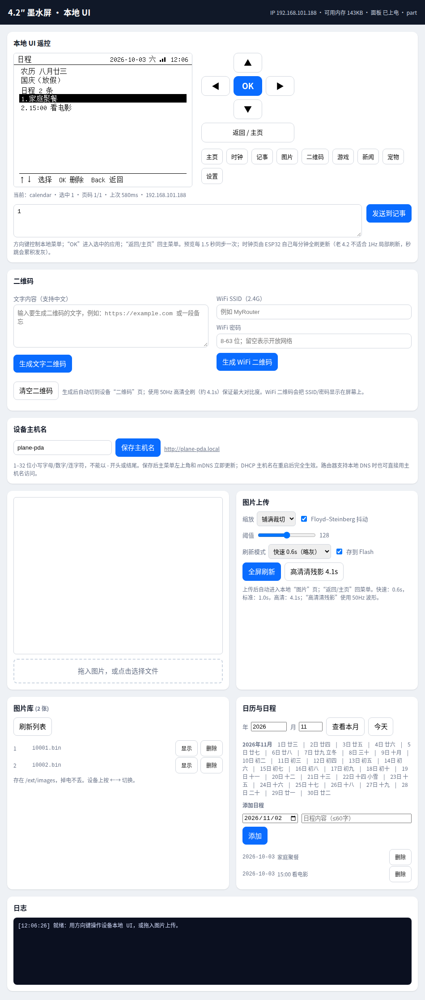

# Calendar

A month calendar on the device with Chinese public holidays, 调休 (make-up
workdays), the 24 solar terms (节气), the **lunar calendar (农历)** and your own
events.

## Device



| Key | Action |
|---|---|
| `←` / `→` | previous / next day (the month follows automatically) |
| `↑` / `↓` | previous / next week |
| `OK` | open the day (holiday, solar term, events) |
| `Back` | home |

In the day view, `↑`/`↓` pick an event, `OK` deletes it, `Back` returns.



Cells show, in order of priority: the holiday name (e.g. `国庆`), `班` on a
make-up workday, the solar term (`立冬`), otherwise the **lunar day** (`廿四`),
with the lunar month name (`十月`) on the first day of a lunar month. Today is
outlined; the selected day is inverted. The bottom bar shows the full lunar date
for the selected day, and so does the day-detail screen.



## Data

- **Holidays / 调休**: State Council notices for 2025
  (国办发明电〔2024〕12号) and 2026 (国办发明电〔2025〕7号).
- **Solar terms**: computed astronomically (Meeus apparent solar longitude,
  Beijing time) for 2025–2035 and embedded as a small table.
- **Lunar calendar**: the classic `lunarInfo` table for 1900–2100 (leap months
  included), converted on the fly; validated against known dates (2025/2026
  春节, 中秋).
- Both are generated by [`tools/gen_calendar_data.py`](../tools/gen_calendar_data.py)
  into `firmware/epaper42_web/calendar_data.h`. Re-run it to extend the range.

## Events

Stored in NVS (namespace `cal`) as `YYYY-MM-DD|text` lines, capped at ~3 KB
(~100 events). Only written when you add or delete an event, so flash wear is
negligible.

### Serial

```text
> cal                                   # selected day + its events
> cal add 2026-11-10 体检 09:00
> cal del 2026-11-10 1
> cal list
> cal today
> cal goto 2026-10-01
```

### Web

The **日历与日程** card shows the annotations for a month and lets you add /
delete events. `GET/POST /api/calendar?y=&m=`, `GET/POST /api/calendar/events`,
`POST /api/calendar/event?date=YYYY-MM-DD`, `DELETE /api/calendar/event?date=&idx=`.



## Notes

- Years outside 2025–2035 still render the grid; holidays are only known for
  2025–2026, solar terms for 2025–2035 and lunar dates for 1900–2100.
- `调休` days are marked as workdays (`班`), so a long holiday's make-up Saturday
  is visible at a glance.
