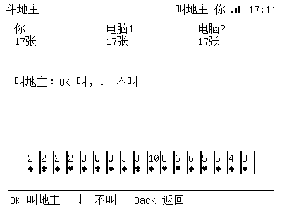

# Games

The Home menu has a **游戏** entry with four modes:

| Item | Mode |
|---|---|
| 五子棋 · 人机 | 15×15 Gomoku, you (black) vs a heuristic AI (white) |
| 五子棋 · 双人 | two players alternate on the same device |
| 斗地主 · 人机 | simplified Dou Dizhu, you vs two AI players |
| 斗地主 · 三人 | three players alternate on the same device |

Games use the existing D-pad / OK / Back input (web remote or serial `key ...`).
Every move is drawn with a full standard refresh (~1 s), which keeps the board
clean on the old 4.2″ panel. The status bar shows the current turn / result.

## Gomoku

- Cursor moves with `←↑↓→`; `OK` places a stone; `Back` returns to the game menu.
- After the game ends, `OK` restarts the same mode.
- AI is a heuristic: it scores every empty cell near existing stones for both
  attack and defence (open/closed 4/3/2 patterns) and plays the best combined
  move. It blocks immediate fives and takes immediate wins.

## Dou Dizhu (simplified)

- Deal 17 cards each + 3 landlord cards; a short bidding round (`OK` = 叫地主,
  `↓` = 不叫). If all pass, the hand is redealt.
- Supported combinations: single, pair, triple, triple + single, bomb, rocket,
  and single straights (≥5). Straight pairs / triple + pair are not implemented.
- Cards show the rank on top and a 7×9 pixel suit icon (spade/heart/diamond/club) below; jokers show 小/大 with a star.


- Play phase:
  - `←→` move the card cursor
  - `↑` select / deselect the current card
  - `OK` play the selected combination
  - `↓` pass (when not leading)
  - `Back` return to the game menu
- The AI follows with the smallest legal combination that beats the last play,
  and leads with a low card. It is intentionally simple; the game is playable but
  not a strong opponent.

## Controls summary

| Key | Gomoku | Dou Dizhu |
|---|---|---|
| `←↑↓→` | move cursor | move / select card |
| `OK` | place stone / restart | bid / play |
| `↓` | move cursor | pass / 不叫 |
| `Back` | exit to game menu | exit to game menu |

## Web / serial

The web remote has a **游戏** shortcut; the D-pad works the same as on the
device. Serial console:

```text
> app games     # game menu
> app gomoku    # start Gomoku vs AI
> app ddz       # start Dou Dizhu vs AI
> key down / key ok / key back
```

`app games` opens the menu; use `key down` + `key ok` to pick 双人/三人 modes.
