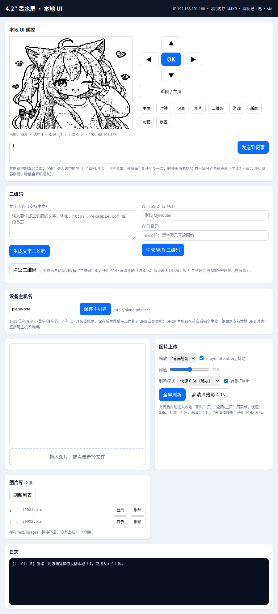

# Image gallery

The **图片** app stores pictures on the external flash (`/ext/images`) instead of
RAM, so they survive a reboot and you can keep several.

## How it works

- Every upload is converted to a 400×300 1bpp frame (15 000 bytes) in the
  browser and posted to `/api/full?mode=<fast|std|hq>&save=1`.
- With `save=1` the frame is written once as a new file `i0000.bin`, `i0001.bin`,
  … Nothing is ever overwritten.
- The list is rebuilt by scanning `/ext/images` at boot, so no index file has to
  be maintained (and rewritten) on flash.
- The current position is a single 4-byte NVS key, written **only when you
  actually move to another picture**.

## Screenshots

## Using it

| Where | Action |
|---|---|
| Device | 图片 app, `←` / `→` to move through the gallery; status bar shows `3/7` |
| Web | 图片上传 card → tick **存到 Flash** → 全屏刷新; 图片库 card lists / shows / deletes |
| Serial | `img` list, `img show <n>`, `img del <n>`, `img rescan` |

## HTTP API

| Method | Path | Result |
|---|---|---|
| GET | `/api/images` | `{"ok":1,"cur":N,"count":M,"items":[{"idx","name","size"}]}` |
| POST | `/api/full?mode=std&save=1` | display + persist a new picture |
| POST | `/api/images/select?idx=N` | show picture N |
| POST | `/api/images/delete?idx=N` | delete picture N |
| POST | `/api/images/rescan` | rescan the directory |

## Flash wear

The W25Q128 is rated for ~100 000 erase cycles per sector. Everything here is
designed so that normal use writes as little as possible and never concentrates
writes on one sector:

1. **LittleFS does the wear levelling.** All access goes through LittleFS on the
   `ext` partition — a log-structured, copy-on-write filesystem that allocates a
   different block each time instead of rewriting a fixed sector. The firmware
   never writes raw flash at a fixed offset.
2. **Pictures are append-only.** A new upload always creates a new file; an
   existing picture is never rewritten, so no block is erased repeatedly.
3. **Duplicate suppression.** If the uploaded frame is byte-identical to the one
   currently shown, nothing is written at all.
4. **No scratch/log files.** The image app is read-only while a picture is
   displayed. There is no "last frame" file and no periodic flash logging.
5. **Selection is 4 bytes in NVS**, written only on change. NVS has its own
   wear-levelled partition with spare sectors.
6. **Free space is kept.** LittleFS needs free blocks to rotate through; the
   200-picture cap (~3 MB of 16 MB) leaves most of the chip free, and deleting a
   picture returns its blocks to the allocator.

A picture is 15 000 bytes ≈ 4 flash pages. Even replacing a picture every few
minutes would take years to approach the endurance limit, and the append-only
scheme means wear is spread across the whole chip rather than a hot sector.
