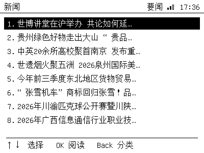
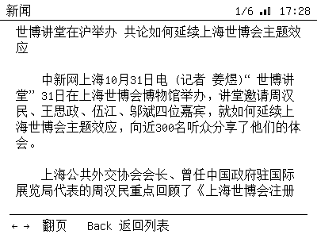

# News reader

The **新闻** app fetches today's Chinese news over Wi-Fi, lets you pick a
category, then a headline, and reads the article as plain text on the e-paper.

## Categories and sources

| Category | Source |
|---|---|
| 要闻 / 国内 / 国际 / 社会 / 体育 / 财经 | China News Service RSS (`chinanews.com.cn/rss/...`) |
| 科技 | ITHome RSS (`ithome.com/rss/`) |

The feeds are public RSS; no API key is required. Each list shows the first
6–10 items the feed returns, with the headline and (where available) a summary.

## Reading an article

Selecting a headline fetches the article page over HTTPS and converts it to
plain text (paragraphs, no images). Long articles are paginated at 11 lines per
page. If the page cannot be parsed, the RSS summary is shown instead.

## Controls

| Key | Categories | List | Article |
|---|---|---|---|
| `←↑↓→` | `↑↓` choose | `↑↓` choose | `←→` page |
| `OK` | fetch category | open article | — |
| `Back` | Home | back to categories | back to list |

Web remote: the **新闻** shortcut plus the D-pad.
Serial: `app news`, then `key ...` as above.

## Notes and limits

- Requires an internet connection; if Wi-Fi is down the app shows an error.
- HTTPS uses `setInsecure()` (no certificate validation) to keep the firmware
  small; the content is public news, not credentials.
- No offline cache yet: lists and articles are kept in RAM only.
- Article extraction is generic (finds the main paragraph container); unusual
  page layouts may fall back to the RSS summary.
- Images, video and interactive content are ignored.
- The feed order/content is controlled by the source; this app does not filter
  or editorialize.
