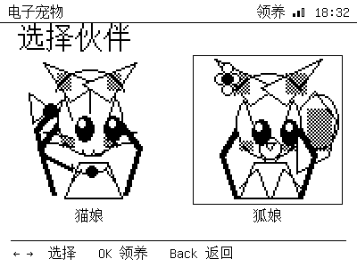
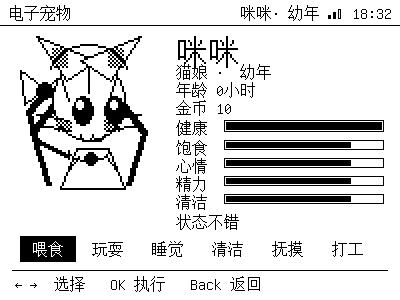

# Electronic pet

A small Tamagotchi-style pet that lives in the device. It keeps its own state in
NVS, keeps ageing while the device is off, and reacts to the six actions on the
action bar.

## Species

Choose **猫娘** (cat) or **狐娘** (fox) when you adopt. The sprites are converted
from the user's `references/catbw.jpg` / `references/foxbw.jpg` black-and-white
chibi artwork: 192×192 1bpp with Floyd-Steinberg dithering, shown 1:1.
The conversion is done by
[`tools/gen_pet_sprites.py`](../tools/gen_pet_sprites.py) into
`firmware/epaper42_web/pet_sprites.h`. The sprite is static: the earlier
two-frame breathing animation was removed because the alternating frames left a
blurry double image on this panel.



## Stats

| Stat | Meaning |
|---|---|
| 健康 | overall health; reaches 0 if the pet is neglected |
| 饱食 | hunger; feed to raise |
| 心情 | happiness; play / pet to raise |
| 精力 | energy; sleep or rest to raise, play/work lowers |
| 清洁 | cleanliness; clean to raise, poop lowers it |
| 金币 | currency; feeding costs 2, working earns 5 |

Time passes while the app is open: hunger/happiness/energy/cleanliness slowly
drop, poop appears every ~2.5 h, and low stats damage health. While the device is
off, the pet is treated as sleeping: it ages from the saved NTP timestamp, gets
hungry/tired more slowly, recovers energy and cannot die offline (capped at one
day per absence).

## Actions

| Action | Effect |
|---|---|
| 喂食 | −2 coins, +28 hunger, +4 happy, −4 clean |
| 玩耍 | +20 happy, −14 energy, −6 hunger |
| 睡觉 | toggle sleep; sleeping restores energy and slows other decay |
| 清洁 | +30 clean, removes one poop |
| 抚摸 | +8 happy (20 s cooldown) |
| 打工 | +5 coins, −18 energy, −10 happy |



Growth stages are 幼年 (<1 day), 成年 (1–7 days) and 老年 (>7 days).

## Controls

| Key | Action |
|---|---|
| `←→` | choose an action |
| `OK` | execute |
| `Back` | save and return to Home |

Web remote: **宠物** shortcut + the D-pad. Serial:

```text
> app pet
> pet                  # status
> pet feed / play / sleep / clean / touch / work
> pet adopt cat|fox
> pet name 小咪
> pet reset / save / unadopt
```

## Notes

- The pet is saved to NVS (`pet` namespace) on every action and once a minute.
- Death is permanent until you adopt again (`OK` on the death screen).
- The sprite is static and the stats refresh every 5 minutes. These updates
  always use a **full refresh**; partial refresh caused ghosting on the pet
  screen, so the pet never uses partial updates. The breathing animation was
  removed because the alternating frames made the dithered sprite look blurry.
